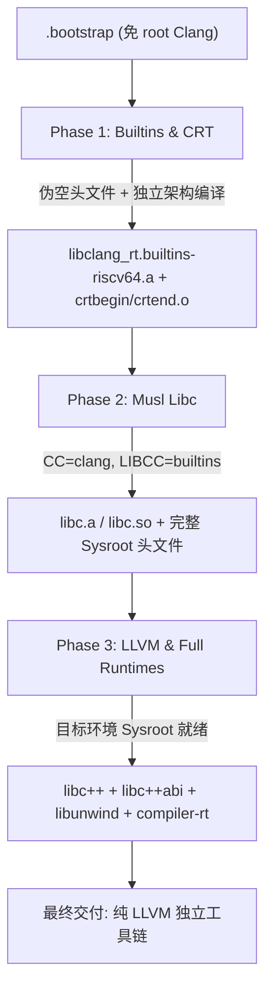

# RISC-V LLVM + Musl 工具链系统架构与循环依赖解决

本文档深入解析本工具链的依赖解耦原理、Sysroot 组织结构以及 Clang 驱动配置机制。

---

## 1. 传统交叉编译工具链的死锁难题

在构建一个全新的 C/C++ 交叉编译工具链时，通常存在经典的三方“死锁”依赖：
1. **C 标准库 (Musl)** 编译需要：
   - 目标架构的 C 编译器；
   - 编译器内置底层算法库（如 64 位除法、浮点模拟、原子操作等 builtins）。
2. **编译器底层库 (compiler-rt builtins)** 编译需要：
   - 基础 C 库头文件或系统调用支持。
3. **C++ 标准库 (libc++ / libc++abi / libunwind)** 编译需要：
   - 完整的 C 运行库头文件与 libc 动态/静态库。

---

## 2. 本工具链的三步解耦方案



### 第一步：自举编译 Builtins (`03_builtins.sh`)
- 使用 `.bootstrap` 里的预编译 Clang 编译 `llvm-project/compiler-rt/lib/builtins`。
- 传入 `-DCOMPILER_RT_BAREMETAL_BUILD=ON`，并构建一套临时的最小 dummy include 避免对宿主 glibc 的依赖。
- 同时通过 `-DCOMPILER_RT_BUILD_CRT=ON` 生成关键的 ELF 初始化对象 `crtbegin.o` 和 `crtend.o`。

### 第二步：编译 Musl Libc (`04_musl.sh`)
- 调用 `./configure`，将 `CC` 设置为引导 Clang，并将 `LIBCC` 指向第一步编译出的 `libclang_rt.builtins-riscv64.a`。
- 编译并安装 `libc.a`（及可选的 `libc.so`）、标准头文件至 `install-clang-musl/riscv64-unknown-linux-musl`。
- 将 Linux 内核头文件软链接或安装至 Sysroot，形成完整的目标 C 环境。

### 第三步：构建 LLVM 与完整 Runtimes (`05_llvm.sh`)
- 以刚刚生成的完整 Sysroot 为目标，配置 LLVM 的运行时多架构构建：
  ```cmake
  -DLLVM_RUNTIME_TARGETS="riscv64-unknown-linux-musl"
  -DRUNTIMES_riscv64-unknown-linux-musl_LLVM_ENABLE_RUNTIMES="compiler-rt;libcxx;libcxxabi;libunwind"
  -DRUNTIMES_riscv64-unknown-linux-musl_DEFAULT_SYSROOT="..."
  ```
- 这样，`libc++` 与 `libunwind` 就能找到标准的 `musl` 头文件与符号，顺畅完成构建与安装。

---

## 3. Sysroot 目录组织结构

最终安装目录 `install-clang-musl/` 的组织形式如下：
```text
install-clang-musl/
├── bin/
│   ├── clang, clang++, lld, llvm-*
│   ├── riscv64-unknown-linux-musl-clang -> clang
│   ├── riscv64-unknown-linux-musl-clang++ -> clang++
│   └── riscv64-unknown-linux-musl.cfg     <-- 核心驱动配置
├── lib/
│   ├── clang/<version>/lib/riscv64-unknown-linux-musl/
│   │   ├── libclang_rt.builtins-riscv64.a
│   │   ├── crtbegin.o
│   │   └── crtend.o
│   └── cmake/                             <-- 提供给 torch-mlir 等外部组件的 CMake 导出
│       ├── llvm/
│       └── mlir/
└── riscv64-unknown-linux-musl/            <-- Sysroot 根目录
    ├── include/                           <-- Musl + Linux Kernel 头文件
    └── lib/                               <-- libc.a, libc++.a, libunwind.a, libc.so 等
```

---

## 4. 驱动配置文件 (`.cfg`) 机制

LLVM/Clang 原生支持依据程序名称自动加载同名的 `.cfg` 配置文件。
当执行 `riscv64-unknown-linux-musl-clang` 时，Clang 自动读取 `riscv64-unknown-linux-musl.cfg`：

```text
--target=riscv64-unknown-linux-musl
--sysroot=<INSTALL_DIR>/riscv64-unknown-linux-musl
-fuse-ld=lld
--rtlib=compiler-rt
--unwindlib=libunwind
-static                                    # 静态构建模式下默认注入
```

这使得用户可以直接执行：
```bash
riscv64-unknown-linux-musl-clang hello.c -o hello
```
无需手动拼接冗长的 `--target`、`--sysroot`、`--rtlib` 等参数。
