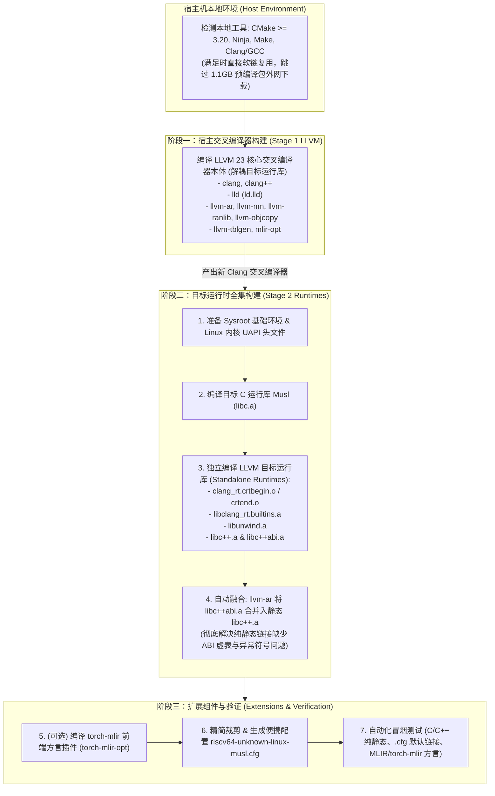

# riscv-llvm-musl-toolchain

从零构建面向 **RISC-V 64** 的现代、纯净、无 GCC 依赖的 **LLVM + Musl** 交叉编译工具链：
`Clang + LLD + compiler-rt + libc++ + libc++abi + libunwind + Musl libc`

---

## 🌟 项目特性

- **100% 纯 LLVM 生态闭环**：彻底摒弃 GCC、GNU Binutils 和 `libgcc`，所有底座运行时由 `compiler-rt builtins` 和 `libc++` 提供。
- **默认纯静态库与自包含链接**：Musl libc、libc++、libc++abi、libunwind 目标运行时默认仅构建静态库（`.a`），且内置配置文件默认启用 `-static`，直接生成完全自包含的静态 ELF 二进制，杜绝动态加载器依赖。
- **免 root 宿主自举**：全自动准备独立的 Clang、CMake、Ninja 与必要依赖，不依赖宿主机系统全局开发环境，不污染宿主系统。
- **专为二次开发设计**：支持通过 `LLVM_SRC` 环境变量直接挂载本地自研/二次开发的 LLVM 源码树，支持微调自研指令、调度模型与优化 Pass 并快速迭代。
- **全方位调试模式支持**：提供 `--debug` (RelWithDebInfo + Assertions) 与 `--full-debug` (Debug -O0) 一键切换，智能保留调试符号，支持 GDB/LLDB 源码级调试与 TableGen 编译加速。
- **工业级瘦身与裁剪**：自动剔除 Windows、macOS、GPU Offload、Python 静态分析等数十个无关跨平台冗余组件，执行宿主符号剥离（Strip），体积减少 >60%（离线发布包仅 ~100MB）。
- **即开即用（Relocatable & Zero-flags）**：内置 `riscv64-unknown-linux-musl.cfg` 便携配置文件与 15 个标准三元组软链接，无需输入长串 `--target`、`--sysroot` 与 `-static` 参数。

---

## 🏗️ 工具链构建架构与自举流水线 (2-Stage Bootstrapping)

本工具链采用正统的**“宿主本地工具优先接入”**与**“两阶段自举（2-Stage Bootstrapping）”**设计：
1. **本地环境优先**：构建时首先检测宿主机是否已有符合要求的 CMake（>= 3.20）、Ninja、Make 和 Clang/GCC，满足要求时直接复用，**完全跳过下载 1.1GB 外部预编译包与 deb**，秒级完成引导；
2. **两阶段解耦构建**：
   - **阶段一（Stage 1）**：使用宿主编译器先构建 LLVM 核心交叉编译器本体（运行于 x86_64，支持 RISC-V 目标架构），解耦目标运行库；
   - **阶段二（Stage 2）**：将目标平台的 **`clang_rt.crtbegin.o`**、**`libclang_rt.builtins.a`**、**`libc.a`**、**`libc++.a`**（含 `libc++abi.a` 融合）以及 **`libunwind.a`** 全部统一定义为目标运行时（Runtimes），在 LLVM 核心编译器生成后，由新鲜出炉的最新 LLVM 亲自交叉编译生成，保证目标运行库血统高度纯正。

### 架构流程图 (Mermaid & ASCII)



```text
[宿主本地环境 (优先复用系统 CMake/Ninja/Clang/GCC，跳过 1.1GB 外部下载)]
                           │
                           ▼
  1. 【bootstrap】  本地工具链 0 秒探测接入（无外网依赖）
  2. 【fetch】      源码检出与锁定 (LLVM 23.1.4 / Musl 1.2.5 / torch-mlir v20261001)
                           │
                           ▼
  3. 【llvm】       阶段一：用本地编译器构建 LLVM 23 核心交叉编译器本体
                    产物：clang, clang++, lld, llvm-ar, llvm-nm, mlir-opt (运行于 x86_64)
                           │
                           ▼ （由刚生成的 LLVM 23 交叉编译目标架构全部运行库）
  4. 【runtimes】   阶段二：全套目标运行时统一构建
                    ├── ① 准备 Linux 内核 UAPI 头文件到 Sysroot
                    ├── ② 编译目标 C 运行库 Musl: libc.a
                    ├── ③ 编译目标启动辅助对象: clang_rt.crtbegin.o / crtend.o
                    ├── ④ 编译目标基础函数库: libclang_rt.builtins.a
                    ├── ⑤ 编译目标堆栈展开库: libunwind.a
                    └── ⑥ 编译目标 C++ 标准库: libc++.a (自动融合 libc++abi.a)
                           │
                           ▼
  5. 【torch-mlir】 阶段三：编译 PyTorch 到 MLIR 前端方言插件 (torch-mlir-opt)
  6. 【prune】      精简无用工具，生成 riscv64-unknown-linux-musl.cfg 默认静态配置
  7. 【verify】     全套自动化冒烟测试 (C/C++ 纯静态、.cfg 默认链接、MLIR/torch-mlir)
```


## 🚀 快速开始

### 1. 基础构建（官方发布版本）
克隆本仓库后，直接运行脚本：
```bash
./build.sh
```
构建完成后，工具链将生成在 `install-clang-musl/` 目录下（默认纯静态库体系与默认静态链接）。

### 2. 常用构建选项与组合

工具链支持自由组合标志（如 `--step llvm --debug`、`--step musl --release --share` 等），**默认未指定库类型时编译纯静态库，显式指定 `--shared` 或 `--share` 时才编译动态库**：

```bash
# 1. 基础与模式构建
./build.sh                     # 默认标准构建 (Release + 纯静态库 + 默认静态链接)
./build.sh --default           # 显式重置并按默认标准配置构建
./build.sh --release           # 显式以 Release 优化模式构建
./build.sh --debug             # 开启推荐二次开发调试模式 (RelWithDebInfo + Assertions + 保留符号)
./build.sh --full-debug        # 开启纯单步调试模式 (Debug -O0 -g + Assertions + 保留符号)

# 2. 静态库与共享库控制 (默认纯静态库)
./build.sh --shared            # 构建目标共享库 (.so) 与静态库 (.a)（亦支持 --share）
./build.sh --static            # 显式指定仅构建目标静态库 (.a)（默认行为）
./build.sh --no-static-link    # 静态库模式下不默认向 .cfg 追加 -static (亦支持 --no-default-static)

# 3. 目标架构变体 (Target Variants)
./build.sh --target riscv64-linux-musl     # 默认标准 RISC-V 64 (rv64gc / lp64d)
./build.sh --target riscv64-linux-musl-rvv # 启用 RVV 1.0 矢量扩展 (rv64gcv / lp64d，内置 .cfg 自动装载)
./build.sh --target riscv32-linux-musl     # 切换至 RISC-V 32 Musl 目标平台

# 4. 并发任务调度与 ccache 编译加速
./build.sh -j 16               # 手动指定并行线程数 (默认 auto: 依据 CPU 与物理内存自适应计算防 OOM)
./build.sh --ccache            # 强制启用 ccache 编译加速 (若系统无则自动下载免 root 引导版本)
./build.sh --no-ccache         # 显式禁用 ccache 加速

# 5. 独立子运行时编译 (极速二次开发迭代)
./build.sh --step musl         # 仅独立编译并安装目标 C 运行库 (libc.a / Linux 头文件)
./build.sh --step compiler-rt  # 仅独立编译目标编译器核心库 (libclang_rt.builtins.a / crtbegin.o)
./build.sh --step libc++       # 仅独立编译目标 C++ 运行时 (libc++.a / libunwind.a 并自动融合 ABI)
./build.sh --step runtimes     # 编排全套目标运行时流水线 (musl -> compiler-rt -> libc++)

# 6. 灵活定制子项目、MLIR 与编译参数 (支持 torch-mlir 扩展)
./build.sh --enable-mlir                       # 启用 MLIR 子项目构建 (clang;lld;mlir)
./build.sh --enable-torch-mlir                 # 快捷启用 MLIR + torch-mlir 完整流水线构建
./build.sh --projects "clang;lld;mlir" --debug # 自定义启用的 LLVM 子项目列表
./build.sh --targets "RISCV;X86"               # 自定义后端架构 (如增加 Host JIT 架构)
./build.sh --cmake-args "-DLLVM_BUILD_EXAMPLES=OFF" # 透传任意额外 CMake 参数
./build.sh --step torch-mlir                   # 单独编译 torch-mlir 组件 (自动对接 MLIR 与源码)
./build.sh --step torch-mlir --torch-mlir-src /path/to/torch-mlir # 挂载自定义 torch-mlir 源码
./build.sh --llvm-src /path/to/custom-llvm     # 命令行直接挂载本地自研 LLVM 源码
./build.sh --musl-src /path/to/custom-musl     # 命令行直接挂载本地自研 Musl 源码

# 7. 单步独立调试与维护
./build.sh --step llvm --debug           # 以调试模式单独重编 LLVM 模块
./build.sh --step runtimes --release --share # 以 Release 模式编译目标全套运行库并生成共享库 (.so)
./build.sh --step verify                 # 单独运行产物校验与冒烟测试 (含 RVV/C/C++ 测试)
./build.sh --rebuild-llvm --debug        # 重编 LLVM 及运行库并开启调试模式
./build.sh --from llvm                   # 从 llvm 阶段开始向下连续执行至 verify
./build.sh --package                     # 构建完成后自动打包为 .tar.zst 离线发布包
./build.sh --clean                       # 清理编译临时目录与时间戳（保留 .bootstrap）
./build.sh --clean-all                   # 清理所有内容（包括 .bootstrap 引导环境）
```

---

## 🛠️ LLVM 二次开发与平滑升级指南

本工具链构建系统采用**构建编排（Builder）与 LLVM 源码完全解耦**的架构，便于长期的芯片定制开发、MLIR/torch-mlir 扩展与定制组件接入。

### 1. 灵活定制编译参数与扩展组件 (MLIR / torch-mlir)
如果您需要开启 MLIR、接入 torch-mlir、增加目标架构、或者挂载本地自研源码：
```bash
# 方式 A：命令行参数直接指定（推荐，支持自由组合）
./build.sh --enable-mlir --debug
./build.sh --enable-torch-mlir --debug             # 一键构建 MLIR + 自动对齐的 torch-mlir
./build.sh --projects "clang;lld;mlir" --targets "RISCV;X86" --debug
./build.sh --cmake-args "-DLLVM_BUILD_EXAMPLES=OFF"
./build.sh --step torch-mlir                       # 单独构建 torch-mlir (由 LLVM 版本自动对齐)
./build.sh --step torch-mlir --torch-mlir-version <commit> # 指定特定 torch-mlir 提交
./build.sh --step torch-mlir --torch-mlir-src /path/to/torch-mlir
./build.sh --llvm-src /path/to/your/custom-llvm --debug

# 方式 B：通过 config/local.env 或环境变量配置
LLVM_ENABLE_PROJECTS="clang;lld;mlir" ./build.sh
LLVM_SRC=/path/to/your/custom-llvm ./build.sh
MUSL_SRC=/path/to/your/custom-musl ./build.sh
```
`build.sh` 会自动检测并挂载对应的源码树进行编译，产出包含您自定义特性的专属工具链。

### 2. LLVM 主控驱动的 torch-mlir 版本对齐体系

本工具链采用 **“以 LLVM 版本为主控基准，下游 torch-mlir 自动适配对齐”** 的架构：
- **设计初衷**：在交叉工具链中，LLVM 是核心编译器基石，而 torch-mlir 是基于 MLIR 的前端扩展方言。由于 MLIR 内部 C++ API 演进频繁，版本必须严格契合。
- **动态推导**：无论使用的是基准 LLVM 还是自定义 LLVM 源码，构建系统会根据当前 LLVM 的 commit/提交时间戳，自动在 `torch-mlir` 仓库中检索兼容的集成节点并自动切换。
- **开箱即用**：在 `config/default.env` 中固化了官方黄金配对组合，用户只需 `./build.sh --enable-torch-mlir` 即可全自动完成版本对齐与端到端编译。

### 3. 日常二次开发与调试模式（Debug / RelWithDebInfo / Assertions）

LLVM 二次开发调试与普通软件开发不同：
- **纯 Debug 模式 (`-O0 -g`)**：二进制极其庞大（单个 clang > 2GB），链接极耗内存（容易触发 OOM），编译器运行慢 10~20 倍。
- **黄金调试组合（业界推荐）**：`RelWithDebInfo + Assertions=ON`。
  - 保留 `-O2` 运行速度（日常编译测试无需漫长等待）；
  - 保留完整 GDB/LLDB 调试符号（断点调试时可直接查看源码行号与变量）；
  - 自动开启 LLVM 核心断言（**最关键机制**：Pass 或 ISel 语法与逻辑写错时，直接在终端精准指出哪行断言失败，杜绝静默段错误）；
  - 自动启用 `-DLLVM_OPTIMIZED_TABLEGEN=ON`，避免调试版代码生成器拖慢整体编译。

#### 构建命令速查：
```bash
# 1. 开启二次开发推荐调试模式 (RelWithDebInfo + Assertions + 自动保留符号)
./build.sh --debug

# 2. 结合本地自研源码增量调试重编 (二次开发最高频操作)
LLVM_SRC=/path/to/my-llvm ./build.sh --rebuild-llvm --debug

# 3. 极速内循环调试（仅增量重编 clang 本体并安装，数十秒内完成）
.bootstrap/bin/ninja -C build-llvm-musl clang install

# 4. 纯无优化单步调试模式 (-O0 -g + Assertions)
./build.sh --full-debug
```

#### 持久化配置（免命令行参数）：
复制并编辑 `config/local.env`：
```bash
cp config/local.env.example config/local.env
```
在文件中配置：
```bash
LLVM_SRC="/path/to/my-llvm"     # 挂载本地自研源码
BUILD_TYPE="RelWithDebInfo"     # 调试模式
ENABLE_ASSERTIONS="ON"          # 开启断言抓 Bug
STRIP_SYMBOLS="OFF"             # 保留调试符号
ENABLE_SHARED="OFF"             # 仅编译目标静态库 (默认 OFF)
DEFAULT_STATIC_LINK="ON"        # 默认静态链接模式 (默认 ON)
```

#### 使用 GDB 源码级调试 Clang 编译器：
构建完成后，可以直接使用 GDB 对 Clang 编译过程进行动态追踪：
```bash
# 启动 GDB 调试 Clang 编译测试程序
gdb --args install-clang-musl/bin/riscv64-unknown-linux-musl-clang -O2 test.c

# 在 GDB 中对自研 Pass 或指令选择函数设置断点
(gdb) b RISCVISelDAGToDAG.cpp:450
(gdb) run
(gdb) bt                        # 查看完整崩溃或调用堆栈
(gdb) p Node->dump()           # 打印 SelectionDAG 节点状态
```

### 3. 如何跟进官方 LLVM 版本升级
当上游 LLVM 发布新大版本（例如 18 -> 19 -> 20）时：
1. **源码同步**：在您的自研 `llvm-project` 仓库中直接拉取并变基：
   ```bash
   git fetch upstream
   git rebase upstream/release/23.x
   ```
   只需专注于解决纯代码层面的冲突，构建系统不受任何干扰。
2. **更新脚本配置**：如需升级默认拉取的官方版本，只需在 `config/versions.lock` 中修改 `LLVM_REF` 为上游的目标分支或版本标签（例如 `llvmorg-23.1.4` 或 `release/23.x`）即可，亦可在命令行直接传入 `./build.sh --llvm-version <REF>`。

---

## 💻 工具链使用示例

把工具链 `bin` 目录加入环境变量，或直接绝对路径调用。**由于已默认启用静态库与静态链接，无需再手动添加 `-static`**：

### 1. 编译 C 语言程序（默认产出纯静态 ELF 二进制）
```bash
riscv64-unknown-linux-musl-clang hello.c -o hello
```

### 2. 编译 C++ 语言程序（默认静态链接 libc++ 与 libunwind）
```bash
riscv64-unknown-linux-musl-clang++ main.cpp -o main
```

### 3. 启用 RISC-V 向量扩展（RVV / Vector）
```bash
riscv64-unknown-linux-musl-clang -march=rv64gcv rvv_app.c -o rvv_app
```

---

## ⚡ 独立子运行时编译与微调 (musl / compiler-rt / libc++)

在二次开发底层库、调试 C 库系统调用或调整 C++ 异常处理机制时，重新跑全量流水线非常耗时。本工具链将阶段二的目标运行时彻底解耦为三个完全正交、可独立调度的子步骤：

### 1. 核心子步骤与调用方式
- **`./build.sh --step musl`**：
  - 自动解包并同步 Linux 内核 UAPI 头文件至 `$SYSROOT/usr/include`；
  - 使用当前已编译好的 Clang 独立编译并安装 Musl C 库生成 `libc.a`；
  - 独立耗时：仅需 **~5 秒**。
- **`./build.sh --step compiler-rt`**（兼容别名: `builtins`）：
  - 依赖：自动保证 Musl C 库就绪；
  - 独立通过 Ninja 目标编译并安装 `libclang_rt.builtins.a` 与 `clang_rt.crtbegin.o / crtend.o`；
  - 自动部署至 Clang 资源库目录；
  - 独立耗时：仅需 **~1 秒**。
- **`./build.sh --step libc++`**（兼容别名: `libcxx`、`libunwind`）：
  - 依赖：自动保证 Musl 与 compiler-rt 就绪；
  - 独立编译 LLVM 官方 `libunwind`、`libc++` 与 `libc++abi`；
  - 自动运行 `llvm-ar -M` MRI 脚本将 `libc++abi.a` 融合入静态 `libc++.a`，并同步部署至 `$SYSROOT`；
  - 独立耗时：增量仅需 **~10 秒**。
- **`./build.sh --step runtimes`**：
  - 统一流水线入口，按顺序执行 `musl -> compiler-rt -> libc++` 并完成全套标记。

### 2. 依赖链自动满足与时间戳状态机
当您仅运行 `./build.sh --step libc++` 时，构建系统具备自动依赖回溯机制：若前置的 musl 或 compiler-rt 尚未构建，会自动按依赖拓扑完成前置步骤，再执行目标步骤；若前置步骤已完成，则利用时间戳跳过，实现瞬时增量编译。

---

## 🚀 性能优化与加速体系 (ccache & RAM 自适应调度)

针对大型编译器项目编译消耗资源高、易 OOM、耗时长的痛点，工具链内置了两大关键优化：

### 1. ccache 编译加速（秒级增量）
- **自动探测与优雅降级 (`ENABLE_CCACHE=AUTO`)**：
  默认情况下，脚本自动检测宿主机是否存在 `ccache`。若检测到则自动向 LLVM 与运行时 CMake 注入 `-DLLVM_CCACHE_BUILD=ON`，若无则平滑禁用，绝不中断构建。
- **显式强制启用 (`--ccache`)**：
  用户传入 `--ccache` 时，即使宿主未安装系统级 ccache，脚本也会通过免 root 引导机制自动下载官方自包含二进制至 `.bootstrap/bin/ccache` 并启用加速。
- **显式禁用 (`--no-ccache`)**：关闭 ccache 缓存。

### 2. 物理核心与 RAM 资源感知自适应调度 (Prevent OOM)
- **业界痛点**：盲目使用 `make -j$(nproc)` 在 16 线程但仅有 16GB 内存的机器上编译 LLVM C++ 源码与进行 LLD 大文件链接时，瞬间消耗全部内存并触发 Linux OOM Killer 杀掉编译进程。
- **智能计算公式**：
  脚本读取 `/proc/meminfo` 的物理可用内存，按每个重型编译/链接任务预留 **2GB 物理内存** 进行并发数计算：
  $$\text{JOBS} = \min\left(N_{\text{cpu}}, \max\left(1, \left\lfloor\frac{\text{RAM}_{\text{GB}}}{2}\right\rfloor\right)\right)$$
  - 在 **32 核 128GB RAM** 高性能服务器上，自动跑满 **32 核心** 全速构建；
  - 在 **16 核 16GB RAM** 机器上，自动将并发限制为 **8**，彻底杜绝 OOM 崩溃；
  - 用户仍可随时通过 `-j <N>` 或 `--jobs <N>` 手动强制指定。

---

## 🎯 目标架构变体 (RVV 1.0 矢量扩展与 32位平台)

除了默认的标量标准架构外，工具链支持通过纯声明式配置快速切换目标架构平台：

| 平台名称 (`--target <名称>`) | 架构与 ABI | 默认配置特性与用途 |
| :--- | :--- | :--- |
| **`riscv64-linux-musl`** (默认) | RV64GC (lp64d) | 工业级标准 64 位通用计算平台，默认静态链接 |
| **`riscv64-linux-musl-rvv`** | RV64GCV (lp64d) | **开启 RISC-V 矢量 1.0 (Vector 1.0)** 扩展，内置 `.cfg` 自动注入 `-march=rv64gcv -mabi=lp64d`，并附带 RVV C Intrinsics 冒烟测试 |
| **`riscv32-linux-musl`** | RV32IMAFDC (ilp32d) | 面向嵌入式与资源敏感型 RISC-V 32 位应用场景 |

使用示例：
```bash
# 一键构建支持 RVV 1.0 的专属矢量交叉编译器
./build.sh --target riscv64-linux-musl-rvv
```

---

## 🐳 容器化构建 (Docker 100% 可重现)

为了保证在任意 Linux 发行版（Ubuntu / Debian / Arch / Fedora / Alpine）甚至 macOS/Windows 上获得 100% 字节级一致的编译环境，项目根目录提供了标准化的 `Dockerfile` 与 `.dockerignore`：

```bash
# 1. 构建官方标准构建镜像
docker build -t riscv-llvm-musl:latest .

# 2. 挂载当前目录进行构建 (产物输出到本地 install-clang-musl 目录)
docker run --rm -v "$(pwd):/workspace" riscv-llvm-musl:latest ./build.sh --default

# 3. 运行特定步骤或变体构建
docker run --rm -v "$(pwd):/workspace" riscv-llvm-musl:latest ./build.sh --target riscv64-linux-musl-rvv
```

---

## 📂 仓库结构

```text
riscv-llvm-musl-toolchain/
├── build.sh                      # 【主入口】参数解析、环境加载、流水线编排调度
├── Dockerfile                    # 【容器化】标准化 100% 可重现构建环境镜像配置
├── .dockerignore                 # Docker 构建上下文忽略文件
│
├── config/                       # 【配置层】纯声明式环境与目标配置
│   ├── default.env               # 全局通用配置（版本、依赖 URL、自适应并发、ccache 开关）
│   ├── local.env.example         # 用户本地配置模板（可自由覆盖变量且被 Git 忽略）
│   └── targets/                  # 目标平台配置目录
│       ├── riscv64-linux-musl.env    # RISC-V 64 Musl 标准平台配置
│       ├── riscv64-linux-musl-rvv.env# RISC-V 64 RVV 1.0 矢量扩展配置
│       └── riscv32-linux-musl.env    # RISC-V 32 Musl 目标平台配置
│
├── third_party/                  # 【第三方源码组件（Git Submodule 管理）】
│   ├── llvm/                     # LLVM 项目源码 (@ release/23.x，内含 compiler-rt 与 MLIR)
│   ├── musl/                     # Musl C 库源码 (@ master / v1.2.6)
│   ├── torch-mlir/               # torch-mlir 源码 (@ main)
│   └── linux-headers/            # Linux 内核 UAPI 头文件 (@ master / sabotage-linux)
│
├── scripts/                      # 【执行层】模块化独立步骤流水线
│   ├── common.sh                 # 公共基础设施（RAM 感知并发计算、日志、断点续传下载）
│   ├── bootstrap.sh              # 阶段 1：智能探测本地工具（含 ccache、cmake、ninja、clang）
│   ├── fetch.sh                  # 阶段 2：准备源码 (Submodule 更新或挂载本地源码) 并自动应用补丁
│   ├── llvm.sh                   # 阶段 3：全量构建 LLVM 核心交叉编译器本体 (支持 ccache)
│   ├── runtimes.sh               # 阶段 4：解耦编译全套目标运行时 (支持 step_musl, step_compiler_rt, step_libcxx)
│   ├── torch_mlir.sh             # 扩展阶段：配置并构建 torch-mlir 插件组件 (torch-mlir-opt)
│   ├── prune.sh                  # 阶段 5：精简裁剪、Strip、三元组软链接与生成 .cfg 配置文件
│   ├── verify.sh                 # 阶段 6：构建产物自愈检查与 C/C++/RVV 矢量冒烟测试
│   └── package.sh                # 阶段 7：打包发布 (tar.zst) 与计算 SHA256 校验和
│
├── patches/                      # 【拓展层】组件补丁目录（自动检测应用）
│   ├── llvm/                     # LLVM 自定义补丁 (*.patch)
│   ├── musl/                     # Musl 自定义补丁 (*.patch)
│   ├── torch-mlir/               # torch-mlir 自定义补丁 (*.patch)
│   └── linux-headers/            # linux-headers 自定义补丁 (*.patch)
│
├── linux-headers/                # 根目录兼容软链接 (指向 third_party/linux-headers)
├── .gitmodules                   # Git Submodule 配置声明 (llvm, musl, torch-mlir, linux-headers)
├── .gitignore                    # 忽略构建缓存与本地配置
└── README.md                     # 架构与使用文档
```

---

## 📦 依赖组件与源码版本说明

| 组件 | 仓库地址 (Upstream) | 固定版本 / 分支 / Commit | 选型与版本考量 |
| :--- | :--- | :--- | :--- |
| **LLVM** | [llvm/llvm-project](https://github.com/llvm/llvm-project.git) | `llvmorg-23.1.4` (`release/23.x`) | **官方最新发布主版本**，对 RVV 1.0 矢量扩展、Zba/Zbb/Zbc/Zicbo* 位操作与最新指令集提供最前沿的调度模型与优化 Pass，内建包含最新 MLIR 与 compiler-rt。 |
| **Musl libc** | [kraj/musl](https://github.com/kraj/musl.git) | `v1.2.5` | Khem Raj 维护的 OpenEmbedded/Yocto musl 核心仓库，针对 RISC-V 架构系统调用与浮点 ABI 进行了交叉编译增强，全 64 位 `time_t`，代码极度精简易于无 GCC 自举。 |
| **torch-mlir** | [llvm/torch-mlir](https://github.com/llvm/torch-mlir.git) | `v20261001` (`main`) | LLVM 官方 PyTorch 到 MLIR 前端编译器项目。作为 Git Submodule 纳入统一工程化管理，并支持通过 `--torch-mlir-src` 自由挂载本地开发分支。 |
| **linux-headers**| [sabotage-linux/kernel-headers](https://github.com/sabotage-linux/kernel-headers.git) | `master` (Git Submodule) | 面向 Musl libc 优化的轻量级 Linux 内核 UAPI 头文件仓库，专为 RISC-V 目标交叉编译适配，提供必要的系统调用与底层头文件。作为 Git Submodule 纳入 `third_party/linux-headers` 统一工程化管理。 |
