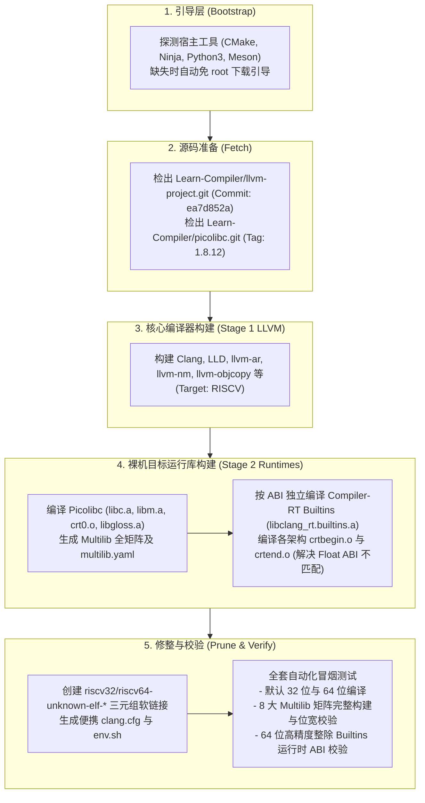

# riscv-llvm-elf-toolchain (LLVM + Picolibc 裸机交叉编译工具链)

从零构建面向 **RISC-V 32 / 64** 裸机（Baremetal）嵌入式环境的现代、纯净、无 GCC 依赖的 **LLVM + Picolibc** 交叉编译工具链：
`Clang + LLD + compiler-rt (builtins/crt) + Picolibc (libc/libm/crt0)`

---

## 🌟 项目特性

- **100% 纯 LLVM 生态闭环**：彻底摒弃 GCC、GNU Binutils 和 `libgcc`，编译器底座由 LLVM Clang + LLD 提供，目标端运行时由 `compiler-rt builtins` 和 `Picolibc` 提供。
- **与 Learn-Compiler 官方基准对齐**：版本与配置严格对齐 [Learn-Compiler/riscv-gnu-toolchain](https://github.com/Learn-Compiler/riscv-gnu-toolchain/tree/master) master 分支：
  - **LLVM**: `git@github.com:Learn-Compiler/llvm-project.git` (Commit: `ea7d852a70e8bdfaf601d6626a760f9771b2c4b4` / `release/20.x`)
  - **Picolibc**: `git@github.com:Learn-Compiler/picolibc.git` (Tag: `1.8.12` / Commit: `2ae376c6cdf4fef90ca2388ecf7a07457fa63cff`)
- **完整的 Multilib 架构矩阵**：针对 RISC-V 裸机常用架构与浮点 ABI 提供原生支持，且为每个矩阵独立构建专用 `compiler-rt builtins` 与 `clang_rt.crtbegin.o/crtend.o`，彻底杜绝浮点 ABI 链接冲突：
  - `rv32i/ilp32` (通用基础 32 位整数架构，无硬件乘除)
  - `rv32im/ilp32` (支持硬件乘除)
  - `rv32iac/ilp32` (支持硬件原子与压缩指令)
  - `rv32imac/ilp32` (默认 32 位基准架构)
  - `rv32imafc/ilp32f` (支持单精度硬件浮点 ABI)
  - `rv32imafdc/ilp32d` (支持双精度硬件浮点 ABI)
  - `rv64imac/lp64` (64 位软浮点架构)
  - `rv64imafdc/lp64d` (默认 64 位双精度硬浮点架构)
- **免参数开箱即用 (Zero-Flags & Relocatable)**：
  - 内置 `clang.cfg`、`riscv32-unknown-elf.cfg` 与 `riscv64-unknown-elf.cfg`，自动定位 sysroot、LLD 链接器、picolibc 链接脚本以及 compiler-rt 运行时。
  - 直接执行 `clang hello.c -o hello.elf` 即可生成 32 位裸机 ELF。
  - 直接执行 `riscv64-unknown-elf-clang hello.c -o hello64.elf` 即可生成 64 位裸机 ELF。
- **免 root 宿主自举**：全自动准备独立的 CMake、Ninja、Meson 与必要自举环境，不污染宿主机全局系统。
- **工业级瘦身与精简**：自动剔除无关的跨平台工具与宿主调试符号（Strip），提供轻量高效的交付产物。

---

## 🏗️ 架构与构建流水线



---

## 🚀 快速开始

### 1. 完整一键构建

```bash
# 默认构建 Release 模式下的完整裸机 ELF 工具链 (含全 Multilib 矩阵)
./build.sh
```

构建产物将安装至 `install-toolchain/` 目录。

### 2. 环境激活

构建完成后，执行以下命令即可将工具链加入环境变量：
```bash
source env.sh
```

### 3. 编译裸机 C 程序示例

编写测试代码 `hello.c`:
```c
#include <stdio.h>

int main(void) {
    printf("Hello from RISC-V Baremetal ELF!\n");
    return 0;
}
```

#### 方式一：免参数默认编译 (自动加载 clang.cfg)
```bash
clang hello.c -o hello.elf
# 输出: 32-bit RISC-V ELF (rv32imac/ilp32)
```

#### 方式二：三元组别名调用
```bash
# 32 位调用
riscv32-unknown-elf-clang hello.c -o hello32.elf

# 64 位调用
riscv64-unknown-elf-clang hello.c -o hello64.elf
```

#### 方式三：指定任意 Multilib 架构矩阵
```bash
# 基础整数架构
clang --target=riscv32-unknown-elf -march=rv32i -mabi=ilp32 hello.c -o hello-rv32i.elf

# 单精度硬件浮点架构
clang --target=riscv32-unknown-elf -march=rv32imafc -mabi=ilp32f hello.c -o hello-rv32imafc.elf

# 双精度硬件浮点架构
clang --target=riscv32-unknown-elf -march=rv32imafdc -mabi=ilp32d hello.c -o hello-rv32imafdc.elf

# 64 位双精度硬件浮点架构
clang --target=riscv64-unknown-elf -march=rv64imafdc -mabi=lp64d hello.c -o hello-rv64gc.elf
```

---

## 🛠️ 常用开发与维护命令

```bash
# 单独执行源码准备
./build.sh --step fetch

# 单独重新编译目标运行库 (Picolibc + Compiler-RT)
./build.sh --step runtimes

# 运行全套自动化冒烟测试与矩阵验证
./build.sh --step verify

# 二次开发推荐调试模式 (附带断言与调试符号)
./build.sh --debug

# 打包离线发布归档 (.tar.zst)
./build.sh --package

# 清理构建缓存
./build.sh --clean
```

---

## 📋 矩阵与三元组映射表

| 目录路径 (`SYSROOT/lib/`) | 对应目标架构 (`-march`) | 对应浮点 ABI (`-mabi`) | 位宽 |
| :--- | :--- | :--- | :--- |
| `rv32i/ilp32` | `rv32i` | `ilp32` (软浮点) | 32-bit |
| `rv32im/ilp32` | `rv32im` | `ilp32` (软浮点) | 32-bit |
| `rv32iac/ilp32` | `rv32iac` | `ilp32` (软浮点) | 32-bit |
| `.` (根目录) | `rv32imac` | `ilp32` (软浮点) | 32-bit |
| `rv32imafc/ilp32f` | `rv32imafc` | `ilp32f` (单精度硬件浮点) | 32-bit |
| `rv32imafdc/ilp32d` | `rv32imafdc` | `ilp32d` (双精度硬件浮点) | 32-bit |
| `rv64imac/lp64` | `rv64imac` | `lp64` (软浮点) | 64-bit |
| `rv64imafdc/lp64d` | `rv64imafdc` | `lp64d` (双精度硬件浮点) | 64-bit |
